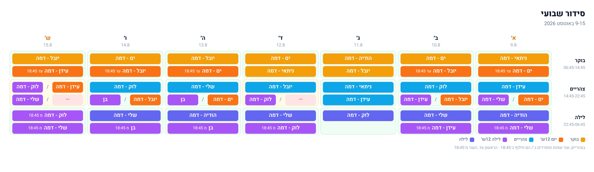
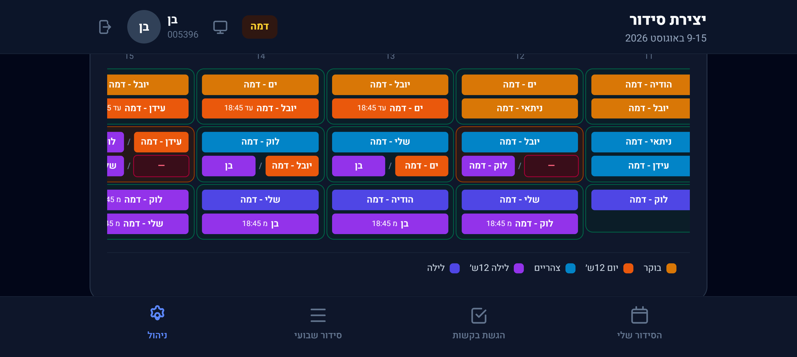
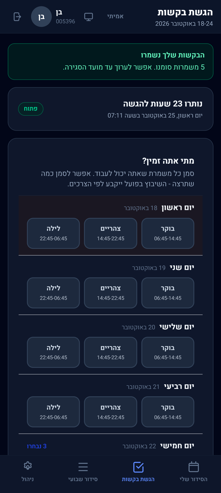
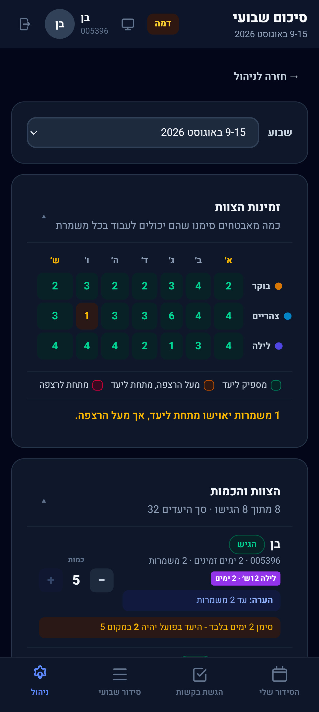
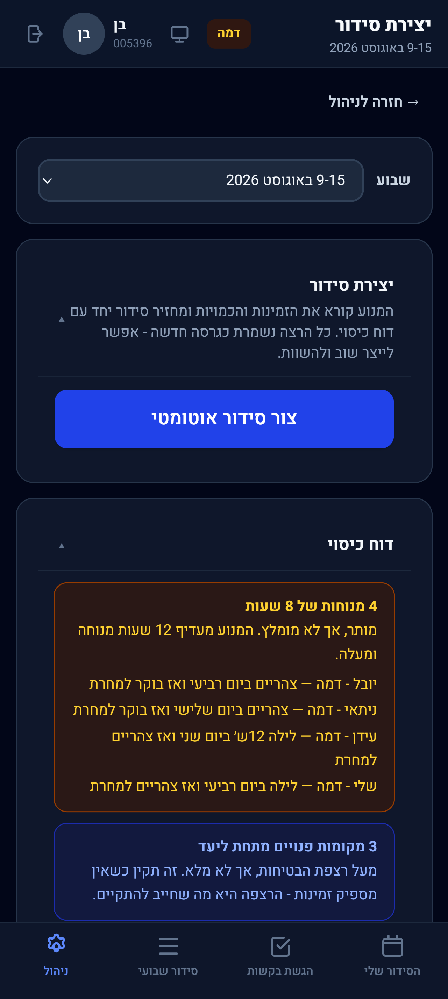
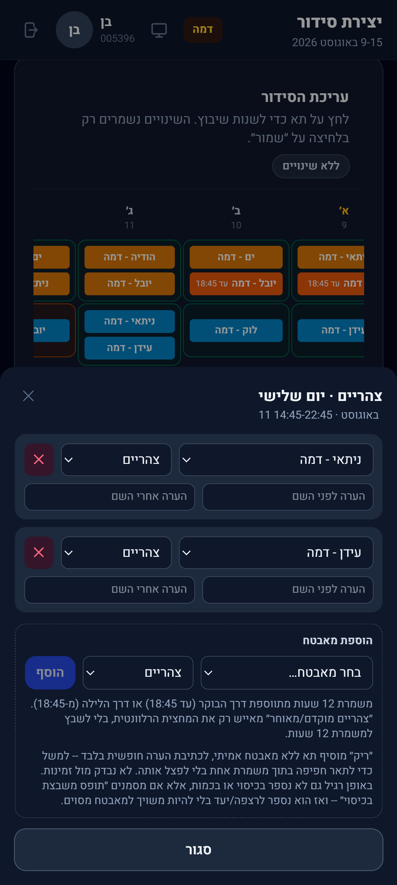
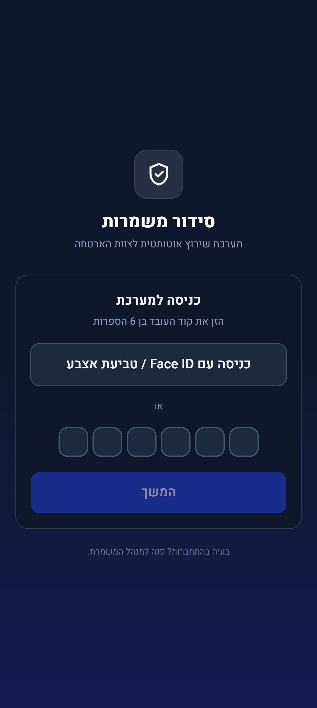

# Work-Organizer: automated shift scheduler for a security team

A mobile-first web app that replaced a security team's weekly WhatsApp scheduling with a
constraint solver. Guards submit their availability from their phones. The manager presses one
button and gets back an optimal roster, a report of anything it couldn't achieve, an editor for
hand adjustments, and a one-tap image export for the team chat.

It's in daily production use by the team it was built for. The UI is Hebrew and right-to-left
(the product is called **סידור אמריקאי**).

**Live:** https://work-organizer-iota.vercel.app. Sign-in uses employee badge codes issued by the
manager, so there is no public demo account.


<sub>A generated week, as exported for the team chat. Rows are morning, afternoon and night;
split cells are 12-hour shifts handing over at 18:45. Names are demo accounts.</sub>

---

## The problem

Every week, about 10 guards each have different availability, and someone has to cover four segments
a day, seven days a week. The rules are strict:

- No guard works two shifts in one day.
- There must be at least 8 hours of rest between shifts. Exactly 8 hours is allowed but discouraged.
- Each guard has a weekly maximum, and a per-guard minimum (כמות) set by the manager.
- 12-hour shifts only go to guards who opt in, day by day.
- Every segment has a target headcount and a lower critical floor. The morning target varies by
  day of the week.
- Rest rules carry over from the previous week's Saturday.

With 8 guards, full target coverage is mathematically impossible in some weeks (spec §2.5). A
hand-built roster usually breaks a rule nobody noticed. The solver's job is to stay strictly
legal, fall short gracefully, and say exactly where and why it fell short.

## How it works

```
React (Vercel)  ──►  Supabase Edge Function  ──►  FastAPI + OR-Tools CP-SAT (Render)
      │               (re-checks manager role,        returns assignments
      │                holds the solver secret)       + coverage report
      ▼
independent referee re-derives every rule  ──►  rejected, or saved to Postgres (RLS)
```

- **Constraint model:** Google OR-Tools CP-SAT. Hard constraints cover availability, rest, daily
  and weekly limits and segment ceilings. A weighted objective ranks coverage floors, then
  per-guard minimums, then target coverage, rest quality and guard preferences, with each weight
  measured on real data rather than guessed (spec §4).
- **Nothing is trusted on the solver's word:** two independent referees, one in TypeScript
  (`src/lib/validate.ts`) and one in Python (`solver/verify.py`), recompute the coverage report
  and objective from scratch. A roster that breaks a hard rule is refused, not saved.
- **Graceful fallback:** if the solver host is asleep, an in-browser greedy engine produces a
  legal (not optimal) roster.
- **Security:** Postgres Row-Level Security is the real access boundary, and the browser holds
  only a publishable key. Login is badge code + personal PIN, with throttled, lockout-protected
  registration. Biometric login is a from-scratch WebAuthn implementation that creates
  device-only credentials, not synced passkeys.
- **Real-time:** Supabase Realtime pushes roster changes to guards and new submissions to the
  manager as they happen.
- **Notifications:** Web Push through the installable PWA. A `pg_cron` tick sends the weekly
  deadline announcement and reminders to guards who haven't submitted yet.

## Features

**For guards:** weekly availability with a two-level preference strength, optional notes and
requested shift count; a personal shift list; and the live published roster.

**For the manager:**
- Week controls: submission window, per-day target overrides, and per-guard minimums.
- A coverage pre-flight matrix.
- One-click generation, version history, and a roster editor with free-text cell
  notes and placeholder rows.
- Publish/unpublish, a JPEG export, and team management.

**Calendar-aware:** detects the Yom Kippur week from the Hebrew calendar each year and schedules
a continuous two-day coverage block around it.

## Screenshots

The UI is Hebrew and right-to-left. All guard names shown are demo accounts.

<p align="center"></p>
<p align="center"><b>In-app roster grid</b><br><sub>The live weekly roster on a phone in landscape. The week scrolls sideways; split cells are two guards on 12-hour shifts handing over at 18:45, and a red dash marks an unfilled slot.</sub></p>

<table>
  <tr>
    <td align="center" width="33%"></td>
    <td align="center" width="33%"></td>
    <td align="center" width="33%"></td>
  </tr>
  <tr>
    <td align="center"><b>Guard availability</b><br><sub>Guards mark the shifts they can work, with a live countdown to the submission deadline.</sub></td>
    <td align="center"><b>Coverage pre-flight</b><br><sub>Before solving, the manager sees how many guards are available per shift, colour-coded against target and floor, plus each guard's minimum.</sub></td>
    <td align="center"><b>Generate + coverage report</b><br><sub>One click runs CP-SAT. The report lists exactly what couldn't be achieved, e.g. each 8-hour rest it had to accept.</sub></td>
  </tr>
  <tr>
    <td align="center"></td>
    <td align="center"></td>
    <td></td>
  </tr>
  <tr>
    <td align="center"><b>Roster editor</b><br><sub>Tap any cell to swap guards, change the shift type, or add a note. Every save is re-checked against the hard rules.</sub></td>
    <td align="center"><b>Login</b><br><sub>Badge code + PIN, or Face ID / fingerprint via a device-bound WebAuthn credential.</sub></td>
    <td></td>
  </tr>
</table>

## Tech stack

| Layer    | Tech |
| -------- | ---- |
| Frontend | React 19, TypeScript, Vite, Tailwind CSS 4, TanStack Query, React Router, Zod |
| Backend  | Supabase: Postgres, Row-Level Security, Auth, Realtime, Edge Functions (Deno), `pg_cron` |
| Solver   | Python, FastAPI, Google OR-Tools CP-SAT |
| Hosting  | Vercel (frontend), Render (solver), Supabase. $0/month on free tiers |
| Other    | WebAuthn (`@simplewebauthn`), Web Push (VAPID), PWA, `@hebcal/hdate` |

## Testing

- **Golden fixtures**: hand-built scheduling scenarios that run through both engines and both
  referees (`npm run test:fixtures`, `solver/tests/test_scheduler.py`).
- **Engine comparison**: asserts CP-SAT never scores below the greedy engine
  (`npm run test:compare`).
- **RLS gate**: applies every migration from scratch in an in-process Postgres (PGlite) and
  checks every policy (`npm run test:rls`).
- **Cloud suites** (`supabase/tests/*.cloud.test.mjs`) cover auth, preferences, manager actions,
  generation, editing, realtime, notifications and WebAuthn. They run against a live project, so
  read each file's setup before running it.

## Repository layout

```
src/                 React app (pages, components, hooks, lib/ = shared rules + referee + mock engine)
solver/              FastAPI + CP-SAT service and its Python referee and tests
supabase/migrations  57 ordered SQL migrations: schema, functions, RLS
supabase/functions   Edge Functions: claim-code, generate-schedule, send-notifications, webauthn, reset-pin
supabase/tests       Cloud and local test suites
```

## Design log

This project was built incrementally and documented as it went:

- [`docs/dynamic-guard-scheduler-spec.md`](docs/dynamic-guard-scheduler-spec.md) is the full technical
  specification: rules, data model, RLS, solver model, and a changelog for every version.
- [`docs/BACKLOG.md`](docs/BACKLOG.md) is the build journal: what shipped, what broke in production, and
  how it was fixed.

## Running locally

```bash
npm install
cp .env.example .env.local   # fill in your own Supabase project; VITE_SOLVER_MODE=mock needs no solver
npm run dev                  # http://localhost:5173
npm run solver:dev           # optional: run the CP-SAT service locally (needs solver/requirements.txt)
```

---

Built by Ben Lachovitz.
